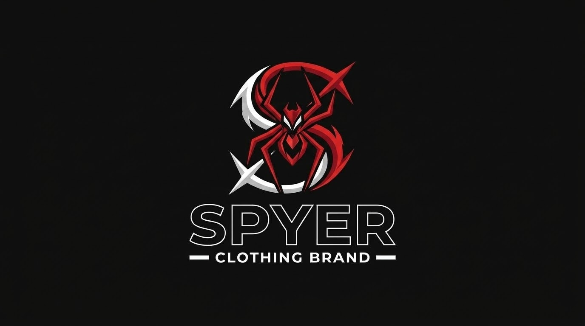

<!DOCTYPE html>
<html lang="ar" dir="rtl">
<head>
<meta charset="UTF-8">
<meta name="viewport" content="width=device-width, initial-scale=1.0">
<title>SPYER — Clothing Brand</title>

</head>
<body class="locked">

  

  🕷️ NEW COLLECTION — HOODIES
  
هوديز بتصميم قوي وجودة عالية — اختر مقاسك بدقة

  
اختر الهودي الخاص بك

  

  
المنتجات: <b id="fc-count">0</b> — المجموع: <b id="fc-total">0 دج</b>

  <button onclick="scrollToOrder()">إتمام الطلب ←</button>

  

    <h3>🛒 معلومات الطلب والتوصيل</h3>

    

      
🧾 المنتجات المختارة

      

لم تختر أي منتج بعد

    

    
<label>الاسم واللقب</label><input type="text" id="fullname" placeholder="أدخل اسمك الكامل">

    
<label>رقم الهاتف</label><input type="tel" id="phone" placeholder="06XXXXXXXX">

    

      <label>الولاية</label>
      <select id="wilaya" onchange="updateDelivery()"><option value="">— اختر الولاية —</option></select>
    

    <label style="font-size:13px;font-weight:700;color:var(--gray-light);display:block;margin-bottom:6px;">نوع التوصيل</label>
    

      

🏠 للمنزل

—

      

🏢 للمكتب

—

    

    
<label>البلدية / العنوان</label><input type="text" id="address" placeholder="اسم البلدية أو العنوان">

    

      
مجموع المنتجات:0 دج

      
سعر التوصيل:—

      
المجموع الكلي:—

    

    <button class="submit" id="submit-btn" onclick="sendOrder()" disabled>تأكيد الطلب الآن</button>
    

    

      <h4>❓ أسئلة شائعة</h4>
      
<b>💳 طريقة الدفع؟</b>الدفع يد بيد عند استلام طلبيتك وإعادة معاينتها.

      
<b>🚚 مدة التوصيل؟</b>التوصيل سريع من يومين إلى ثلاثة أيام كأقصى حد.

    

  

  <h4>تابعنا على مواقع التواصل 🕷️</h4>
  

    <a class="soc" href="[https://www.instagram.com/luna__pack?xtok=MzF1ZDh3cGk5bWt0](https://www.instagram.com/spyer_fit?evlk=N3BhMzM3MnY4amZk)" target="_blank" rel="noopener noreferrer">
      <svg viewBox="0 0 24 24" aria-hidden="true"><path d="M7.5 2h9A5.5 5.5 0 0 1 22 7.5v9a5.5 5.5 0 0 1-5.5 5.5h-9A5.5 5.5 0 0 1 2 16.5v-9A5.5 5.5 0 0 1 7.5 2zm0 2A3.5 3.5 0 0 0 4 7.5v9A3.5 3.5 0 0 0 7.5 20h9a3.5 3.5 0 0 0 3.5-3.5v-9A3.5 3.5 0 0 0 16.5 4h-9zM12 7a5 5 0 1 1 0 10 5 5 0 0 1 0-10zm0 2a3 3 0 1 0 0 6 3 3 0 0 0 0-6zm5.3-3.1a1.2 1.2 0 1 1 0 2.4 1.2 1.2 0 0 1 0-2.4z"/></svg>
      انستغرام
    </a>
    <a class="soc" href="[https://www.facebook.com/share/1K33qXmHeA/](https://www.instagram.com/spyer_fit?evlk=N3BhMzM3MnY4amZk)" target="_blank" rel="noopener noreferrer">
      <svg viewBox="0 0 24 24" aria-hidden="true"><path d="M13.5 21v-8h2.7l.4-3.2h-3.1V7.9c0-.9.3-1.5 1.6-1.5h1.6V3.5c-.3 0-1.3-.1-2.4-.1-2.4 0-4 1.5-4 4.1v2.3H7.6V13h2.7v8h3.2z"/></svg>
      فيسبوك
    </a>
    <a class="soc" href="[https://www.tiktok.com/@luna___pack?_r=1&amp;_t=ZS-9ApjTwB0iwS](https://tiktok.com/@spyer_fit)" target="_blank" rel="noopener noreferrer">
      <svg viewBox="0 0 24 24" aria-hidden="true"><path d="M16.6 3h-3.2v12.2a2.7 2.7 0 1 1-2.7-2.7c.3 0 .5 0 .8.1V9.3a5.9 5.9 0 1 0 5.1 5.9V8.6a7.4 7.4 0 0 0 4.3 1.4V6.8A4.3 4.3 0 0 1 16.6 3z"/></svg>
      تيك توك
    </a>
  

</body>
</html>
